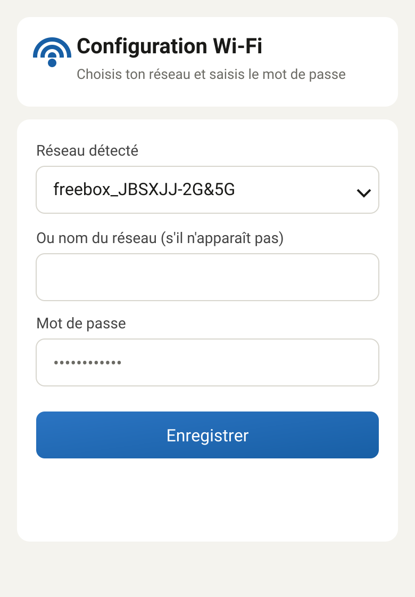
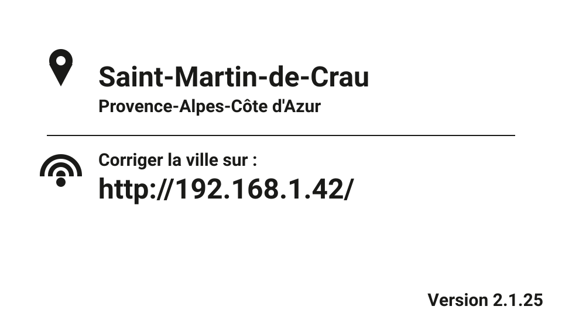
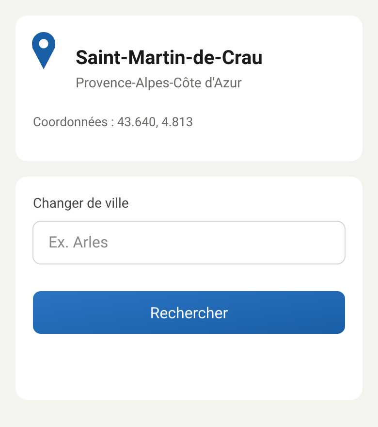
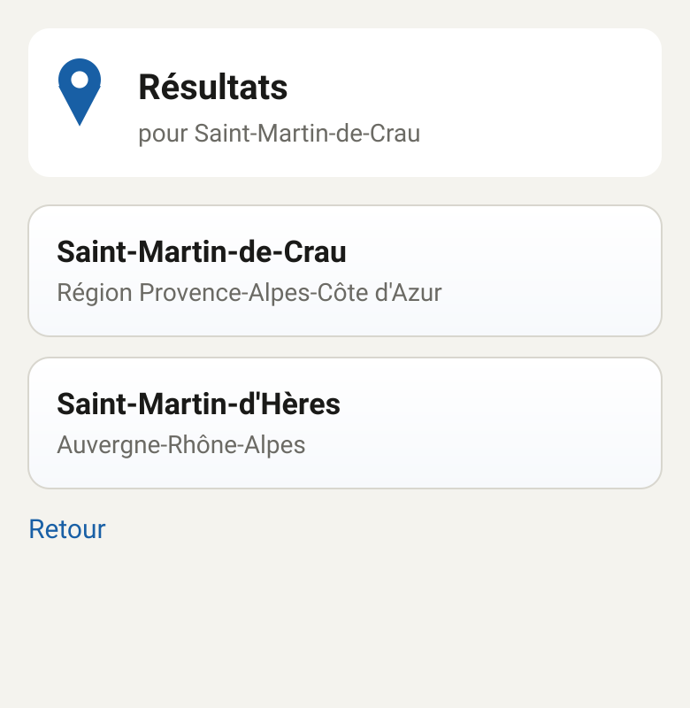
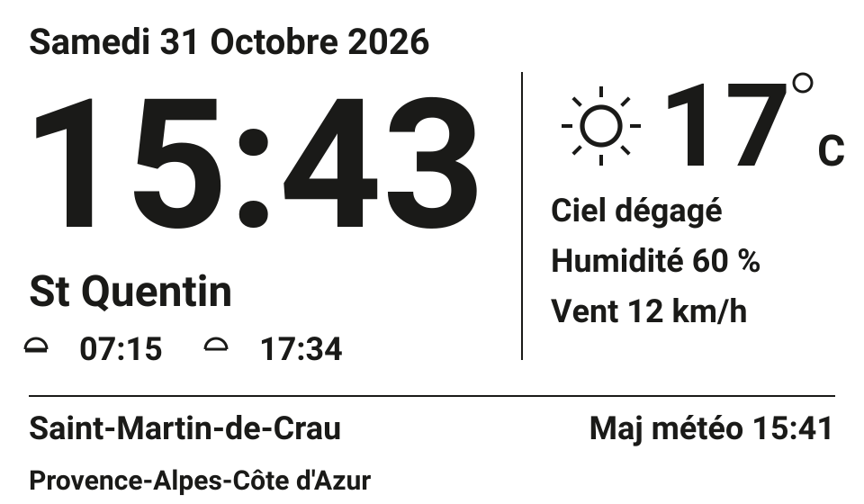

# Horloge e-Paper : Raspberry Pi Pico W + Waveshare Pico-ePaper-3.7

Horloge e-Paper 480 × 280 (SSD1677) pilotée par un Raspberry Pi Pico W.
Elle affiche l'heure, la date, le saint du jour, le lever et le coucher du soleil, et la météo.
La météo vient d'Open-Meteo (sans clé API). La ville se règle depuis un téléphone ou un navigateur.

Version actuelle : **2.1.25** (voir `FIRMWARE_VERSION` dans `Horloge_PicoW.ino`).

---

## 1. Matériel

| Écran (Pico-ePaper-3.7) | Pico W |
|---|---|
| VCC | VSYS |
| GND | GND |
| DIN / MOSI | GP11 |
| CLK / SCK | GP10 |
| CS | GP9 |
| DC | GP8 |
| RST | GP12 |
| BUSY | GP13 |

Bouton externe : **GP0 vers GND** (entrée `INPUT_PULLUP`).

---

## 2. Logiciel et installation

- Arduino IDE, core **Raspberry Pi Pico/RP2040** par Earle Philhower (6.3.1).
- Bibliothèques : **GxEPD2**, **TimeLib** (Adafruit GFX est fournie avec GxEPD2).
- **Tools > Flash Size** : choisir une option **avec FS** (par exemple « 2MB (Sketch 1MB, FS 1MB) »).
  Sans FS, l'écran affiche « Erreur memoire ».
- Ouvrir `Horloge_PicoW.ino`, compiler, téléverser.
- Il n'y a plus de `secrets.h` : le Wi-Fi se configure depuis le Pico (section 3).

### Fichiers

| Fichier | Rôle |
|---|---|
| `Horloge_PicoW.ino` | Programme principal : affichage, bouton, météo, horloge |
| `Config.h / .cpp` | Réglages enregistrés dans la mémoire flash (LittleFS) |
| `Geo.h / .cpp` | Détection de la ville (ipapi.co) et recherche de villes (Open-Meteo) |
| `SetupPortal.h / .cpp` | Page web : configuration Wi-Fi et choix de la ville |
| `SunriseSunset`, `MoonPhase`, `SaintCalendar` | Calculs soleil, lune, saints |
| `Fonts/` | Polices Roboto Bold (15, 18, 20, 24, 26, 64, 84, 100 px) |
| `bitmaps_3_7.h` | Image de démarrage (splash) |

---

## 3. Première configuration

Au premier démarrage, ou si le Wi-Fi enregistré ne se connecte pas, le Pico crée son propre réseau.

```
 Pico ──► crée le réseau  "Horloge-Setup"  (mot de passe : horloge2026)
   │
   └──► affiche sur l'écran l'adresse à ouvrir
          │
Téléphone ──► se connecte à "Horloge-Setup"
          └──► ouvre http://192.168.42.1   (adresse affichée sur l'écran)
                  │
                  └──► page Configuration Wi-Fi  ──► Enregistrer
                          │
                          └──► le Pico redémarre et se connecte au Wi-Fi
                                  │
                                  └──► détecte la ville automatiquement
```

Le mot de passe du point d'accès est dans `SetupPortal.h` (`AP_PASSWORD`). Tu peux le changer.

L'écran de configuration affiche le réseau, le mot de passe et l'adresse à ouvrir, avec une icône pour chaque ligne.

### Écran de configuration (e-paper)


*Écran de configuration (e-paper)*


### Page Wi-Fi (téléphone)



*Page Wi-Fi (téléphone)*


---

## 4. Ville et correction

Après connexion, le Pico détecte la ville par IP (ipapi.co, HTTPS, sans clé).
L'écran de démarrage affiche la ville et l'adresse pour la corriger.

### Écran de démarrage (e-paper)



*Écran de démarrage (e-paper)*


Pour changer la ville, ouvre l'adresse affichée sur le réseau domestique, puis recherche-la.

### Page ville (téléphone)



*Page ville (téléphone)*


### Résultats de recherche (téléphone)



*Résultats de recherche (téléphone)*


Le choix d'un résultat enregistre la ville et la région, sans le pays.
La liste des résultats n'existe que pendant la recherche : si le Pico redémarre entre-temps, refais la recherche.

---

## 5. Écran principal



*Écran principal (e-paper 480 × 280)*


- **Gauche** : date, heure (police 100 px), saint, lever et coucher du soleil.
- **Droite** : icône météo, température, état, humidité, vent.
- **Pied de page** : ville en gros, région en petit dessous, heure de mise à jour de la météo.

### Rafraîchissement de l'écran

| Événement | Rafraîchissement |
|---|---|
| Changement de minute | partiel (seulement les chiffres de l'heure) |
| Changement de jour | complet (date, saint, soleil, météo) |
| Météo mise à jour (20 min, ou 1 min si échec) | complet |
| Toutes les 30 mises à jour partielles, ou 6 h | complet (évite les restes d'affichage) |

---

## 6. Boutons (GP0)

| Action | Effet |
|---|---|
| Appui court | Météo → lune et soleil → retour à l'horloge |
| Appui maintenu 5 s | Mode configuration Wi-Fi (point d'accès `Horloge-Setup`) |

---

## 7. Dépannage

| Message ou symptôme | Cause probable | Action |
|---|---|---|
| « Erreur memoire / LittleFS indisponible » | Pas de partition FS dans l'IDE | Tools > Flash Size : option avec FS, puis téléverser |
| « Echec de l'enregistrement » | Impossible d'écrire `/config.txt` | Voir le moniteur série (« Config: … ») |
| « Heure indisponible » | Wi-Fi ou NTP injoignable | Vérifier le Wi-Fi, ou relancer la configuration |
| « Météo indisponible » | Pas de connexion à Open-Meteo | Vérifier la connexion, la météo revient seule |
| Restes d'affichage sur l'heure | Rafraîchissement partiel | Attendre le rafraîchissement complet (30 mises à jour ou 6 h) |
| Ville tronquée | Ancienne configuration | Refaire la recherche de la ville (2.1.22 sépare automatiquement l'ancien format) |

Moniteur série : 115200 bauds. La première ligne indique la version.

---

## 8. Points de sécurité

- Le point d'accès de configuration a un mot de passe fixe (`horloge2026`) : à changer.
- La page de correction de la ville, sur le réseau domestique, n'a pas de mot de passe.
- La connexion aux services météo et ville ignore la vérification du certificat (`setInsecure`). Acceptable pour des API publiques sans donnée sensible.

---

## 9. Versionnage

La version est dans `Horloge_PicoW.ino` : `FIRMWARE_VERSION`.
**À chaque modification du code, incrémenter cette version** (format MAJEUR.MINEUR.CORRECTIF) :

- CORRECTIF : correction de bug ou petit ajustement
- MINEUR : nouvelle fonctionnalité compatible
- MAJEUR : changement important (ex. format de configuration)

---

## 10. Historique

- 2.0.0 : configuration Wi-Fi via point d'accès, ville détectée automatiquement et corrigeable, météo HTTPS.
- 2.0.1 : affichage du numéro de version (moniteur série et écran d'information).
- 2.0.2 : police de l'heure agrandie (Roboto Bold 130 px), mise en page verticale ajustée.
- 2.0.3 : correction d'un appel de fonction (écran d'information au démarrage).
- 2.0.4 : diagnostic si LittleFS n'est pas activé (message à l'écran et dans le moniteur série).
- 2.0.5 : le point d'accès affiche son adresse réelle (192.168.42.1 par défaut sur arduino-pico) ; logs à l'enregistrement.
- 2.0.6 : sauvegarde de la configuration robuste (formatage LittleFS et nouvel essai si l'écriture échoue).
- 2.0.7 : police de l'heure corrigée (alignement des glyphes).
- 2.0.8 : rafraîchissement complet à chaque minute pour éviter les artefacts sur la grande heure.
- 2.0.9 : test avec la police Roboto Bold 84 px et la mise en page d'origine.
- 2.0.10 : police de l'heure en Roboto Bold 100 px.
- 2.1.0 : écran principal avec météo (icône, température, état, humidité, vent), date, heure, saint et pied de page.
- 2.1.1 : rafraîchissement partiel de l'heure à chaque minute (complet au changement de jour et périodiquement).
- 2.1.2 : espacement vertical plus grand entre la date, l'heure et le saint.
- 2.1.3 : soleil en contour et plus grand ; pied de page avec la région en petite police sous la ville.
- 2.1.4 : heure descendue de 8 px.
- 2.1.5 : lever et coucher du soleil affichés sous le saint.
- 2.1.6 : lignes état, humidité et vent descendues de 5 px.
- 2.1.7 : « C » de Celsius agrandi (police 24 px).
- 2.1.8 : date en police 20 px.
- 2.1.9 : région du pied de page sans retour à la ligne ; diagnostic dans le moniteur série.
- 2.1.10 : région du pied de page sur toute la largeur (police 26 px, 18 px si le nom est trop long).
- 2.1.11 : page web de la ville embellie (icônes, cartes) ; région affichée sous le nom de la ville.
- 2.1.12 : écran de démarrage avec icônes (épingle pour la ville, Wi-Fi pour l'adresse de correction).
- 2.1.13 : région du pied de page sans le pays (coupée à la première parenthèse).
- 2.1.14 : nom de ville complet (la ville était tronquée à 64 octets, accents compris).
- 2.1.15 : région du pied de page en police 20 px (15 px si le nom est trop long).
- 2.1.16 : choix de la ville par indice : le nom complet n'est plus tronqué par le formulaire web.
- 2.1.17 : région du pied de page en police 18 px (15 px si le nom est trop long).
- 2.1.18 : région du pied de page en police 15 px.
- 2.1.19 : page web de la ville : le texte prend toute la largeur à côté de l'épingle.
- 2.1.20 : diagnostic de la ville dans le moniteur série (libellé choisi et valeur lue par la page).
- 2.1.21 : ville et région stockées séparément (plus de découpage du nom).
- 2.1.22 : au chargement, l'ancienne ville « Ville, Région (Pays) » est séparée automatiquement.
- 2.1.23 : icônes météo plus épaisses (traits de 2 px, brouillard en bandes).
- 2.1.24 : pages web (Wi-Fi et ville) : boutons en dégradé, effet au survol et focus sur les champs.
- 2.1.25 : résultats de recherche en cartes (ville en gros, région dessous).
- 2.1.26 : écran de configuration avec icônes (réseau, cadenas, globe).

---

## 11. À valider sur le matériel

- Rendu final de l'écran principal (espacements, icônes météo, lever et coucher).
- Affichage de la région sur une seule ligne, dans toutes les tailles.
- Configuration complète : point d'accès, page Wi-Fi, choix de la ville, redémarrage.
- Reconnexion Wi-Fi après une coupure du routeur.
- Mise à jour météo toutes les 20 minutes.
